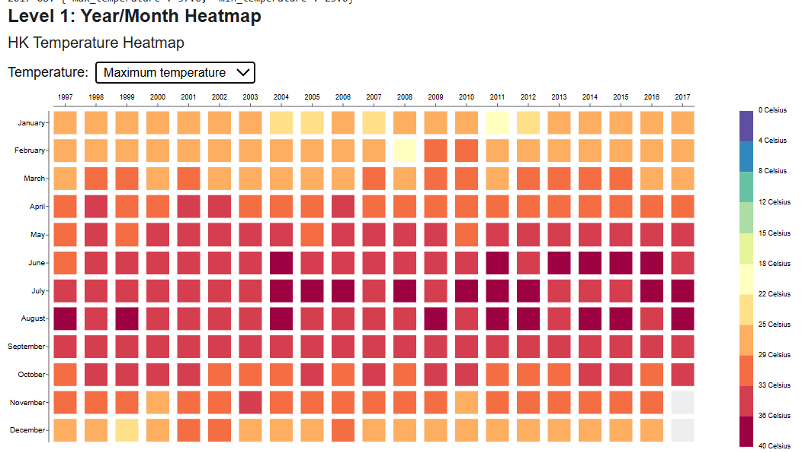
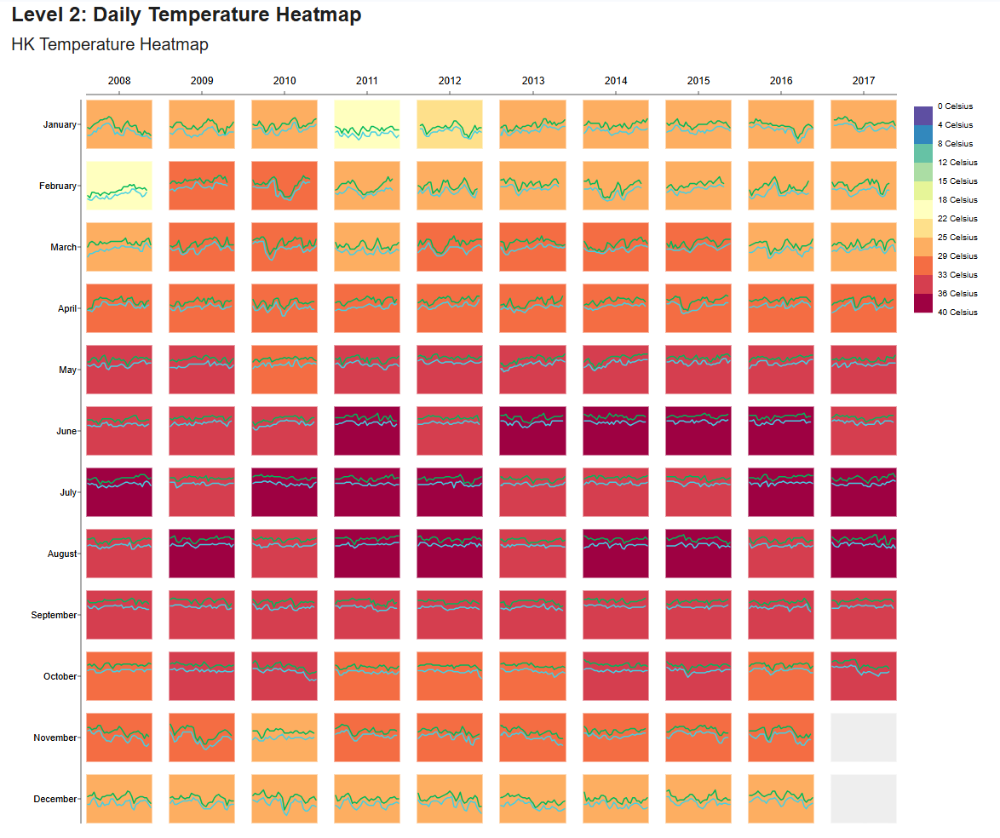

**HK Temperature Heatmap: CSCE-679 Data Visualization Assignment 1**

Live notebook: \[Open in Google Colab\]([https\://colab.research.google.com/drive/1SWedRTMzQjWBMFXsXUj3ZdnQELB9Pz\_B?usp=sharing](https://colab.research.google.com/drive/1SWedRTMzQjWBMFXsXUj3ZdnQELB9Pz_B?usp=sharing) )

**Overview**

This assignment presents two interactive visualizations of Hong Kong temperature data. The project was developed in Google Colab using a notebook that combines Python data preparation with HTML, CSS, JavaScript, SVG, and D3.js v7 for interactive charts.

## Screenshots

### Level 1: Maximum Temperature Heatmap

### Level 1: Minimum Temperature Heatmap

### Level 2: Daily Maximum and Minimum Temperature Trends

**Files**

\- \`HK\_Temperature\_Heatmap.ipynb\`: Google Colab/Jupyter notebook containing data preparation and both visualizations.  
\- \`temperature\_daily.csv\`: source dataset required to run the notebook.  
\- \`README.md\`: this documentation.  
\- \`screenshots/\`: screenshots captured from the notebook output.

**Tools and how they are used**

\- Google Colab: development and execution environment. Python cells prepare the data and display HTML output.  
\- Python: loads, validates, cleans, aggregates, and serializes the temperature data.  
\- pandas: reads the CSV, parses the date and numeric temperature columns, drops rows with invalid required values, and computes monthly summaries.  
\- \`json\`: serializes the prepared Python records so they can be inserted into the JavaScript code.  
\- HTML and CSS: define the chart headings, dropdown, SVG containers, layout, and tooltip styling.  
\- JavaScript: constructs the visual elements and handles mouse and dropdown interactions.  
\- D3.js v7: loaded in the notebook from \`https\://d3js.org/d3.v7.min.js\`. The code uses D3 selections/data joins, \`scaleBand\` for year/month placement, \`scaleLinear\` for daily positions, \`scaleThreshold\` for temperature colors, \`d3.group\` for daily records, and \`d3.line\` for the daily temperature curves.  
\- SVG: draws the heatmap cells, hand-drawn axis lines, tick marks, labels, legend bands, and daily temperature lines.

**Input data and preparation**

The CSV must contain \`date\`, \`max\_temperature\`, and \`min\_temperature\` columns. Python checks these columns, parses dates and numeric values, and removes rows where a required value is invalid. It then groups observations by year and month:

\- Monthly maximum \= the highest daily maximum temperature in that month.  
\- Monthly minimum \= the lowest daily minimum temperature in that month.

Python converts the resulting records to JSON and inserts the data, year bounds, and SVG \`viewBox\` dimensions into the HTML template. Other visual styling and layout options are defined in JavaScript \`CONFIG\` objects inside the notebook cells.

**Level 1: Year/Month Heatmap**

\- Covers 1997-2017.  
\- Years are arranged across columns; January through December are arranged down rows.  
\- Each cell represents one year/month combination.  
\- The temperature dropdown switches the cell colors between monthly maximum and monthly minimum values.  
\- Hovering over a cell displays its year-month and monthly maximum/minimum values.  
\- Missing year/month combinations remain blank instead of being assigned a temperature of zero.  
\- D3 \`scaleBand\` positions the years and months. The year/month axes are drawn with SVG lines, tick marks, and text labels.

**Level 2: Daily Temperature Heatmap**

\- Focuses on 2008-2017.  
\- Each cell represents a month in one year. Its background color represents that month's maximum temperature.  
\- A green line shows daily maximum temperatures; a cyan line shows daily minimum temperatures.  
\- Day of month maps to horizontal position within the cell, and temperature maps to vertical position.  
\- \`makeLineGenerator(field)\` creates a line generator for either daily maximum or daily minimum values.  
\- Hovering over a monthly cell displays the month and its maximum/minimum summary.

Color mapping and legend

Both levels use the same reversed D3 Spectral palette (\`d3.schemeSpectral\[11\].slice().reverse()\`) and the same threshold values: \`4, 8, 12, 15, 18, 22, 25, 29, 33, 36\`. This keeps the color interpretation consistent between levels. The legend is drawn as discrete color bands, with labels placed at the band boundaries from 0 Celsius at the top to 40 Celsius at the bottom.

**Run in Google Colab**

1\. Open the notebook using the \[Colab link\] [https\://colab.research.google.com/drive/1SWedRTMzQjWBMFXsXUj3ZdnQELB9Pz\_B?usp=sharing](https://colab.research.google.com/drive/1SWedRTMzQjWBMFXsXUj3ZdnQELB9Pz_B?usp=sharing)  
 above, or upload \`HK\_Temperature\_Heatmap.ipynb\` to Colab.  
2\. Upload \`temperature\_daily.csv\` (included in this repository) to the Colab session if it is not already present. The notebook prompts for the file if it cannot find it.  
3\. Select Runtime → Restart session and run all (or the equivalent restart-and-run-all option shown in Colab).  
4\. Wait for both cells to complete and confirm both charts render.  
5\. Test the Level 1 maximum/minimum dropdown and hover over cells in both levels to check the tooltips.  
6\. Confirm that legend labels, year/month labels, and chart edges are visible.

The notebook loads D3.js from a public CDN, so the browser requires internet access. The dataset ends on 2017-10-28, so November and December 2017 have no observations.

**Implementation note**

The visualizations are embedded in notebook cells rather than separated into standalone JavaScript files. Python handles data processing and passes JSON into the HTML templates, and D3.js executes in the browser to render the interactive visualizations. The legend/axis drawing and other chart logic remain defined in each level's JavaScript, so some logic is repeated between levels.  
